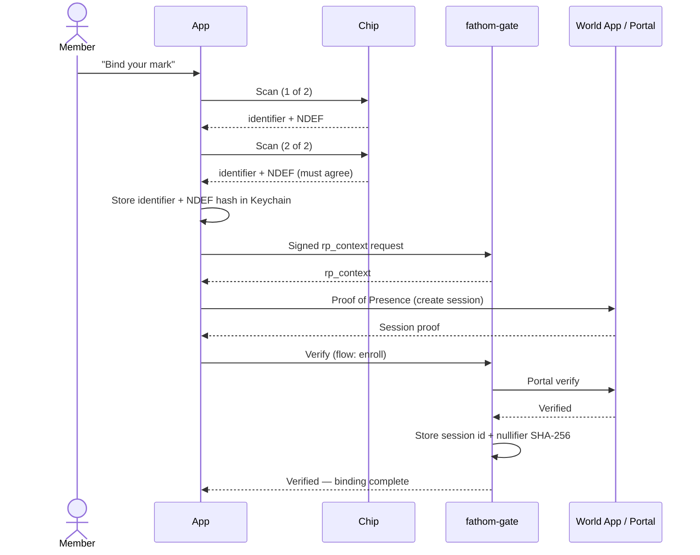
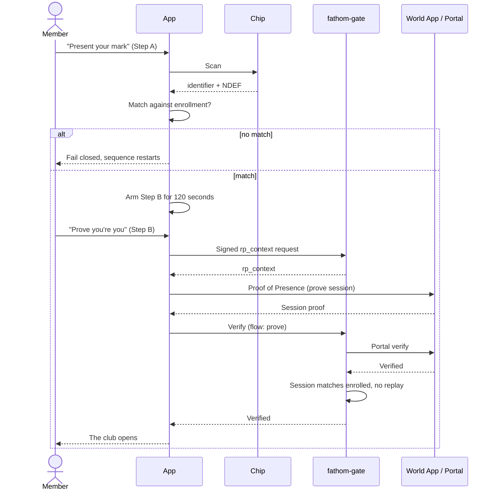

# Fathom — The Fathom Club

A prototype iOS app that is a public example of a two-factor gate made of
two unlike things:

1. **Something you have, physically** — an enrolled NFC chip (in the
   reference build, an NFC implant), scanned with Core NFC.
2. **Someone you are, provably** — a World ID Proof of Presence, checked
   live in the World App and verified by a small backend against the
   nullifier enrolled for that chip.

Neither factor opens the club alone. The chip scan comes first and arms
a short window (120 seconds); the World ID proof must land inside that
window and match the nullifier bound to the chip at enrollment.

The club behind the gate is a demo: a fictional members' club six
fathoms down, with a members' ledger, a nightly program, a cellar list,
house rules, and a local note board. All demo content is fictional and
SFW.

> Status: v0.1. The app ships with a built-in chip diagnostics screen
> (About → Chip Diagnostics) that reports exactly what iOS exposes for
> a given tag — type, identifier, NDEF status and contents, and a
> cross-scan stability summary — because enrollment was designed
> against real scans of real chips, not assumptions.

## The sequence

Enrollment binds the chip and the nullifier as a pair:

Unlock is both factors, in order, inside 120 seconds:

Inside, "Return to the surface" locks immediately, and backgrounding
the app for more than 60 seconds relocks it.

## Honest security model

- The NFC identifier and the NDEF message are a **tier-1 possession
  factor**. They are static and cloneable with commodity gear. They stop
  everyone who has never scanned the tag; they do not stop a determined
  cloner. The design never treats the chip as a sole factor.
- The World ID presence proof is the **personhood factor**: a fresh
  liveness check in the World App, verified server-side, matched to the
  enrolled nullifier, with replay rejection. A valid proof from any
  other human fails closed.
- The backend stores a session identifier and a SHA-256 hash of the
  nullifier only. A World ID humanId never reaches it.
- Production hardening paths, if you take this further: NTAG 424 DNA
  (dynamic per-tap SDM/SUN), MIFARE DESFire EV3, or a JavaCard applet
  (for example VivoKey Apex) for real challenge-response on the chip
  side. Neither is required to understand or run this example.

## Layout

- `Fathom/` — the SwiftUI app (iOS 17+, XcodeGen `project.yml`).
- `backend/` — `fathom-gate`, a small Node reference backend that signs
  `rp_context`, forwards proofs to the World Developer Portal verify
  endpoint, and keeps the chip/nullifier binding.
- `scripts/release-ota.sh` — an over-the-air install-page release helper
  for your own server.

## Running your own

See `backend/README.md` for registering your own World Developer Portal
app and relying party, running the backend, and pointing the app at it.
Release-time configuration (backend URL, gate bearer token, World app
id) is injected at build time and never committed; `project.yml`
carries placeholders only.

## License

MIT.
